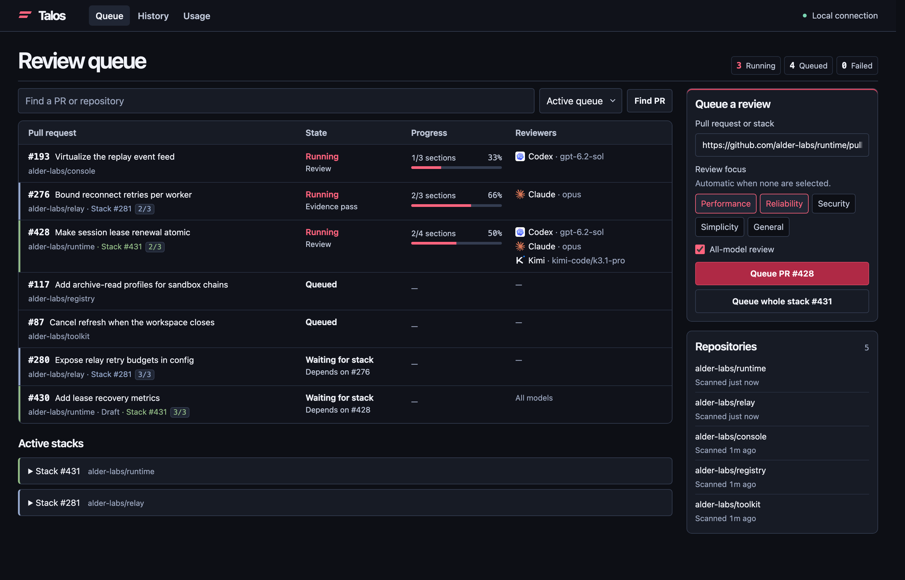
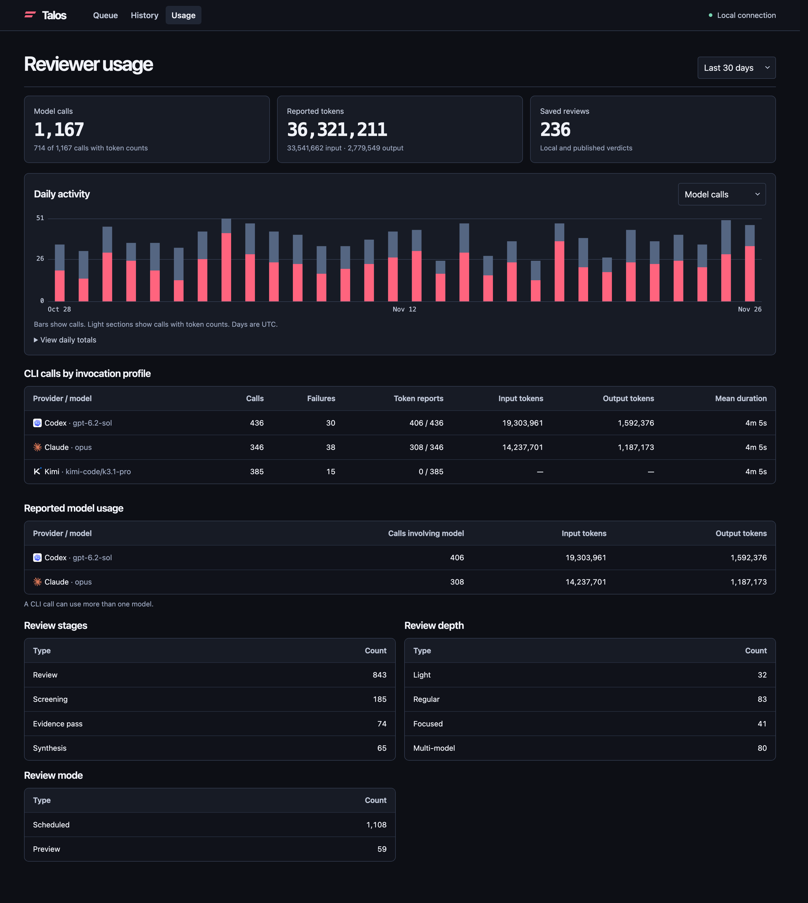
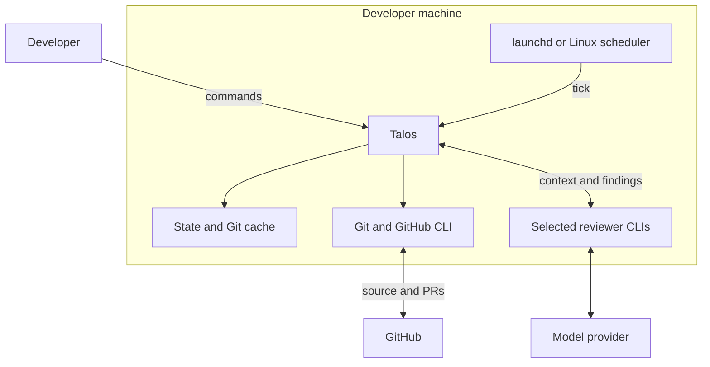

# Talos

Talos reviews open GitHub pull requests, including drafts, from your machine using Codex, Claude Code, or Kimi Code.

[](#monitor-reviews-locally)

Talos baselines existing PRs and picks up new PRs and new heads. Existing drafts are baselined on upgrade and get reviewed on their next head or when marked ready. Talos can post findings on drafts. A clean draft gets a fresh approval decision when it is marked ready. Each repo can opt into comments and approvals separately.

## Use Talos

You need Zig 0.15.2, Git, GitHub CLI with `gh api --slurp`, SQLite, and one reviewer CLI. On macOS, SQLite comes with the system and Zig uses the Xcode Command Line Tools. On Linux, install the SQLite runtime library (`libsqlite3.so.0`) and run `talos tick` from your scheduler.

```sh
git clone https://github.com/paulbalaji/talos.git
cd talos
zig build -Doptimize=ReleaseSafe
mkdir -p "$HOME/.local/bin"
install -m 755 zig-out/bin/talos "$HOME/.local/bin/talos"
export PATH="$HOME/.local/bin:$PATH"
```

Sign in with `gh auth login` and sign in to your reviewer CLI. Replace `OWNER/REPO` and `123` with your repo and an open, ready PR.

```sh
talos add OWNER/REPO                   # Track this repo with your default reviewer
talos run-once OWNER/REPO 123          # Preview this PR, including a baselined PR
talos install                         # Start the macOS scheduler
talos status                          # See scans, queue, errors, and cache sizes
talos scan                            # Refresh discovery for enabled repositories
```

| Do this | Run |
| --- | --- |
| Preview a specific PR with a review mode | `talos run-once OWNER/REPO 123 --mode perf-maxxing` |
| Look for needless complexity in a refactor | `talos run-once OWNER/REPO 123 --mode simplicity` |
| Preview the next eligible reviews | `talos run-once` |
| Preview the next review in one repo | `talos run-once OWNER/REPO` |
| Show or set the reviewer default for new repos | `talos defaults` or `talos defaults --engine claude` |
| Queue a specific PR under the repo's publication policy | `talos queue OWNER/REPO 123` |
| Queue every configured provider at maximum effort for one PR | `talos queue OWNER/REPO 123 --all-maxxing` |
| Queue a review with a focus | `talos queue OWNER/REPO 123 --mode perf-maxxing --prompt 'Check allocations on the request path.' --publish` |
| Read the latest local verdict, its evidence gaps, and recent verdict history | `talos result OWNER/REPO 123` |
| Open a draft for a deferred finding | `talos followup THREAD_URL` |
| Preview a followup | `talos followup THREAD_URL --dry-run` |
| Track drafts and merge readiness | `talos followup status` |
| Pause or resume a followup | `talos followup pause THREAD_URL` or `talos followup resume THREAD_URL` |
| Queue a numbered GitHub stack | `talos stack OWNER/REPO 10088` |
| Queue branches as an explicit stack | `talos stack OWNER/REPO feature 123 124 125` |
| Remove an explicit local stack definition | `talos unstack OWNER/REPO feature` |
| Inspect one repo or read JSON | `talos status OWNER/REPO` or `talos status --json` |
| Show provider starts and cooldowns | `talos usage` |
| Read review and token metrics as JSON | `talos metrics --days 30` |
| Open the local dashboard | `talos dashboard` |
| Keep the dashboard available on macOS | `talos dashboard install` |
| Set a provider’s starts per UTC day | `talos usage codex 40` |
| Show or set the review budget per tick | `talos queue-budget` or `talos queue-budget 3` |
| Exclude or re-enable a PR | `talos ignore OWNER/REPO 123` or `talos unignore OWNER/REPO 123` |
| Pause or resume reviews for a repo | `talos pause OWNER/REPO` or `talos resume OWNER/REPO` |
| Run one scheduler pass | `talos tick` |
| Remove the macOS scheduler | `talos remove` |
| List flags and commands | `talos --help` |

`run-once` always previews. `tick` uses the configured publication policy. A numbered preview also works while its repo is paused.

### Monitor reviews locally

The local dashboard shows tracked jobs, active reviewers, and completed source sections. It also shows coverage gaps, retry times, stack dependencies, and the publication decision for saved reviews. The displayed percentage counts completed sections. Reviewers working on a section can still require additional evidence or synthesis. Stack badges show each PR's position from the bottom of the stack. [Open the local dashboard](http://127.0.0.1:8749).

History distinguishes published reviews, local results that need attention, decisions to stay quiet, and publication still awaiting a receipt. On desktop, the queue, history, repositories, and usage can scroll within the console. Queue a current head again to retry an evidence-blocked review. Completed decisions to stay quiet remain deduplicated.

Hover over a progress bar, a saved verdict, or a day on the usage chart for a breakdown. The same details are available with keyboard focus, and the arrow keys move between chart days.

Paste a GitHub PR or stack link to queue it. If the PR belongs to a GitHub stack, Talos offers a separate action to queue all open members. Pick any combination of Performance, Reliability, Security, and Simplicity. Select General on its own for a broad review, or leave the focuses clear for automatic depth. All-model review can be enabled independently. The dashboard uses the same queue and publication policy as the CLI.

The README screenshots use simulated repositories and review activity.



The dashboard binds to loopback. Browser queue writes require a matching local origin. Keep it on the machine running Talos. Use `talos dashboard remove` to stop the macOS service, or `talos dashboard --port 8750` to run on another local port.

Talos keeps local attempt and verdict metadata indefinitely in SQLite. Attempt records include repository, PR, head, stage, reviewer, model, elapsed time, outcome, and provider-reported tokens when available. The dashboard gives totals by PR and review, and shows advisor model usage separately when the CLI attributes it. Cached input and reasoning tokens are parts of the corresponding input and output totals. The recorded-token share shows how much of the selected range can support token totals. CLI versions with no reported usage still contribute attempt counts. Previously saved verdicts appear in history, and token history begins when the telemetry-enabled watcher starts recording.

The Usage view defaults to 30 days and offers up to 365 days. `talos metrics --days` accepts up to 3,650 days. Queries cap the number of records they read and flag partial totals. Use `talos metrics --days 30 --offset 90` for a 30-day window ending 90 UTC days ago.

### Focus a review

Repeat `--mode` to combine focuses on a numbered preview or queued review. Add `--prompt` to give the configured reviewers specific context or a question.

```sh
talos run-once OWNER/REPO 123 --mode perf-maxxing --prompt 'Check allocations on the request path.'
talos run-once OWNER/REPO 123 --mode perf-maxxing --mode reliability-maxxing
talos run-once OWNER/REPO 123 --mode security-maxxing
```

Performance covers hot paths and scaling. Reliability covers partial failure, retries, and recovery. Security checks trust boundaries and mitigations from static source. With no mode, Talos runs the general review. Talos saves queued prompts locally and sends them to the configured reviewers. Keep credentials out of them. A review with a custom prompt stays local by default. Add `--publish` to allow its result to appear on GitHub when the repo allows comments. Review modes without a custom prompt follow the repo’s comment policy. Focused reviews publish as comments. Queue the same head again with no flags to retry with its saved options.

After a review, Talos checks for substantive PR conversation, human replies to review threads, closed or reopened threads, and changes to the base branch or merge base. A standalone “thanks” or “thank you” does not schedule a review or consume the conversation excerpt budget. Talos checks up to four completed PRs per repo per scan. A rereview includes the previous verdict on individual findings and starts with the bounded diff from the last reviewed commit when that delta is complete. Talos keeps up to 16 notes for each tracked PR. The review receipt prevents a duplicate post after a restart.

Talos puts files with active review threads and risky code early in the bounded diff. It also reads pinned source around current right-side thread anchors. Incomplete current evidence and unassessed open threads prevent approval. Reviewers can still approve when the current head is fully covered and the only gap is a clipped historical delta.

Scheduled reviews split large diffs on Git hunk boundaries. A large hunk can use its own section. If the prompt runs out of room, Talos shortens resolved and fully automated threads and can review some sections as source only. Those sections cannot clear open threads. Hunks outside the section limits keep coverage incomplete. Adaptive rereviews can use one routing pass to consider the previous verdict, available delta, and current discussion. All source sections reuse that decision. Talos checkpoints completed sections and combines their verdicts before it publishes one review. During model runs, the watcher continues scanning due repos and accepts new queue requests.

Once Talos decides the review scope, it can run up to three independent source sections at once within the configured reviewer start budget. Each section keeps its own checkpoint and temporary reviewer directories.

For a sectioned review on the same pinned source, new discussion leaves completed source work intact. New human discussion or edits to the PR description get a focused follow-up pass before publication. Automated threads can inform remaining passes. They do not require a new pass on their own. A clean draft with unchanged source and discussion can reuse its review when marked ready.

A new thread containing only automated replies does not invalidate an in-flight review. Edits to reviewed threads and new human threads still require current inputs.

If a rereview finds an issue after an approval, its comment flags the earlier approval for a person to reassess. On upgrade, Talos uses newer human replies to catch up completed reviews. It tracks resolution changes from the first successful scan.

Rereviews update the local verdict. Talos posts new actionable findings, an approval for a commit that does not already have one from the configured GitHub account, or a warning when an earlier approval needs reassessing. See summaries and coverage details in `talos result`. A custom review with `--publish` can post its requested summary.

`talos ignore OWNER/REPO 123` excludes a PR from discovery, manual reviews, stack reviews, and publication across new commits and restarts. To see ignored PRs, use `talos status OWNER/REPO` or switch the dashboard to All jobs. Existing results stay available. After `talos unignore OWNER/REPO 123`, you can queue a review immediately.

`talos status OWNER/REPO` shows up to five completed jobs still tracked and links to verified GitHub reviews. `talos result OWNER/REPO 123` prints the last saved local candidate and up to seven previous verdict explanations, including after the PR closes. The explanation records the head and base, reviewer-specific gaps, requested evidence, approval blockers, and the GitHub review ID after readback. Older local candidates keep their original JSON fields. A review reconciled from GitHub can have a receipt without a local candidate.

### Audit a merged PR or follow up on a deferred finding

Run `talos audit OWNER/REPO PR` for a local pass over a merged change. Talos checks the original diff against bounded source from the current target branch and prints its exact source pins, actionable findings, and any remaining coverage gaps as JSON.

Copy the link to an inline review comment in a registered repo.

```sh
thread='https://github.com/OWNER/REPO/pull/123#discussion_r456'
talos followup "$thread" --dry-run
talos followup "$thread"
talos followup status
talos followup "$thread" --merge-when-ready
```

The scheduler waits for the original PR to merge, then checks the finding against the current target branch. If it can make a small fix, Talos pushes a branch and opens a draft linked to the thread. It reuses the same draft on retry. The command grants permission to open that draft, including in a repo whose reviews stay local. The dry run prints the proposed replacement and skips the branch and draft.

Talos uses the configured reviewer CLIs to propose changes to the file named in the thread. It can read up to three more source files from the pinned commit, within 24 KiB of extra context. It applies the replacement in an isolated Git index and leaves code execution to GitHub CI. Followups share the review budget and respect repo pauses.

Talos watches the draft from creation. It verifies feedback on the current head, pushes up to three scoped updates, and requires a clean exact-head self-review and passing GitHub checks before marking the draft ready. Feedback outside the original fix and changes from another author can require a human decision. See the Follow-ups tab or `talos followup status --json` for the tracked state.

With `--merge-when-ready`, Talos submits the current head for normal GitHub merge after an independent approval and passing checks. The same flag also opts in an existing followup. Use the thread link shown by `status` to pause or resume. Pausing a followup stops Talos actions. GitHub handles any merge already submitted.

### Review a PR stack

When Talos scans open PRs, it uses the number and member order GitHub recorded for each `gh stack`. When a member has pending review work, Talos queues the stack's other open members, including drafts. Idle native stacks stay baselined, and completed reviews for the current heads are retained.

For PRs without a GitHub stack, Talos can infer a linear chain when each PR targets the previous PR's branch and exact head in the same repo. Ambiguous or branched relationships stay in the ordinary queue. You can also define a local stack with two to eight ready PRs in one repo, bottom to top.

```sh
talos stack OWNER/REPO 10088
talos stack OWNER/REPO feature 123 124 125
talos status OWNER/REPO
talos run-once OWNER/REPO 124
talos unstack OWNER/REPO feature
```

Talos waits for queued ancestor reviews or merges before starting the next scheduled PR. In an inferred stack, a baselined ancestor can contribute its pinned diff and any available review without starting a new model run. Reviewers see excerpts from the nearest ancestors, and Talos rechecks the entire ordered prefix before publication. Each PR keeps its own diff anchors and publication receipt. Use `status` to see the stack number, order, and why a PR is blocked. `unstack` removes an explicit local definition and keeps its queued jobs. A later scan can detect the chain again. [GitHub stack APIs](https://docs.github.com/en/pull-requests/reference/stacked-pull-requests-apis-and-webhooks)

### Route reviews by risk

Fixed routing is the default. To evaluate adaptive routing, use a separate state directory and queue a few ready PRs.

```sh
trial_state=$(mktemp -d)
talos --home "$trial_state" add OWNER/REPO --routing shadow --light-model codex=gpt-6-luna
talos --home "$trial_state" queue OWNER/REPO 123
talos --home "$trial_state" tick
talos --home "$trial_state" status OWNER/REPO --json
```

Shadow runs the configured full review and records the suggested route, per-pass timings, and finding-anchor differences. Compare those results against the actual changes before enabling adaptive routing. Matching anchors are a rough comparison. Check the findings themselves for missed defects and incorrect escalations.

On registry `main`, a complete change that only replaces existing passive chain and Warp route logos can take a regular review. Talos checks the pinned old and new SVGs and permits one registry patch changeset. The reviewer checks geometry, padding, and variants alongside the review threads.

Adaptive routing uses four levels.

| Level | Review |
| --- | --- |
| Light | One lightweight review of a complete, narrowly mechanical image patch bump. Talos saves a clean light review locally. Any finding, unclear discussion, or missing evidence sends it to full review. |
| Regular | The configured reviewer or reviewer group. |
| Focused | The regular reviewers receive the relevant performance, reliability, or defensive security prompts. |
| Multi | At least two providers with distinct briefs. A synthesis pass checks reported issues against the source and combines duplicates. Talos waits if the provider pool cannot supply both reviewers. |

Talos routes contract changes, ownership and signing changes, deployment permissions, and changes to access policy directly to multi-provider review. Other clear risks go to the relevant focused review. A configured lightweight model can recommend a stronger route for ambiguous changes. Manual modes and prompts take precedence. GitHub approvals require a full review.

In adaptive routing, changes to Hyperlane's production CCIP Read verification and commit/reveal authentication use the security, reliability, and performance lenses with every configured full reviewer at maximum effort. Dependent PRs inherit that route from a reviewed open ancestor at the same pinned revision. To request it for all current open members of a GitHub stack, run `talos stack OWNER/REPO STACK_NUMBER --all-maxxing`.

Add `--rerun` after `--all-maxxing` to review completed members again at the same head. Pending all-model jobs keep their progress. The normal publication rules still suppress unchanged findings.

On scheduled reviews, the screening model can request up to six specific files or excerpts from the pinned commit. Talos reads one excerpt per distinct file before repeats. Changes to Hyperlane Merkle snapshot and insertion projections also get pinned schema, writer, and database adapter excerpts. Multi review uses a synthesis pass to verify candidate claims. If that response is malformed, Talos retains the independent passes and tries an eligible provider, resuming on a later tick if needed.

### Configure provider fallback

```sh
talos add OWNER/REPO --engine codex --fallback claude,kimi
talos add OWNER/REPO --routing shadow --light-model codex=gpt-6-luna --light-model claude=haiku
talos usage codex 40
talos usage
```

List only providers approved to receive the repo’s source and discussions. Talos tries the primary reviewer list in order and uses authorized fallbacks when a provider is cooling down or at its daily start cap. A multi-review job keeps successful passes across ticks and restarts while waiting for the remaining independent providers. Talos rechecks the pinned input before reusing a pass. Use `--fallback off` to remove fallback providers and `--light-model ENGINE=off` to remove a screening model. Include publication flags when updating a tracked repo.

`talos usage` counts starts made by this Talos state directory. It includes screening, failed attempts, and previews. Daily caps reset at midnight UTC. A cap of `0` means unlimited. The count estimates local workload. It has no view of requests made by other tools or of the provider’s remaining subscription quota.

Every model start also counts against the per-tick budget. Adaptive routing reserves starts for the review and releases unused starts after the job returns. All-model review and synthesis can resume across ticks when the reservation runs out. Routing reports and accumulated passes are private local state. Screens use standard speed and skip advisor calls.

### Verify on-chain claims

For adaptive reviews of PRs targeting `hyperlane-xyz/hyperlane-registry` main, the screening reviewer can request up to six public EVM reads. Talos uses `curl` and the HTTPS RPC URLs at the pinned base commit. It checks the chain ID, reads at a specific block, and gives the full reviewers the observed values alongside GitHub check statuses. Reviewers can request `owner()`, Safe `getOwners()` and `getThreshold()`, `paused()`, `maxCapacity()`, and whether an address has contract code. The RPC requests share a 30-second budget per review.

A change limited to `maxCapacity` on a supported Warp route gets a regular review with automatic reads. Talos resolves the ISM from the pinned router and looks for a unique rate-limited module bound to that router. It compares the observed capacity with the proposed value. A missing or mismatched read holds approval.

Configure a [lightweight model](#route-reviews-by-risk) to enable these requests. A numbered `run-once` preview includes the observations in its JSON output. Scheduled reviews retain the observations and block heights in `status --json`. Unavailable requested evidence limits coverage and blocks automatic approval. The review checks specific claims about live state. A green CI status by itself does not prove those claims.

### Review registry pin changes

When a PR in `hyperlane-xyz/hyperlane-monorepo` changes `.registryrc`, Talos reads the old and new pins from the PR merge base and head. It adds a bounded GitHub comparison from `hyperlane-xyz/hyperlane-registry`, so reviewers can see the intended metadata update and other changes pulled in by the same bump. Talos withholds automatic approval when the pins diverge or comparison evidence is incomplete.

### Review relayer image pins

For PRs targeting `hyperlane-xyz/hyperlane-monorepo` main, Talos recognizes relayer image tags of the form `abcdef0-20261124-185322` in `typescript/infra/config/docker.ts`. It reads the pinned deployment selectors, hashes the public GHCR manifests, and matches each tagged digest to a successful main build log for the exact source commit. Reviewers receive the changed build input inventory for each image pair and bounded patch excerpts, with bundled runtime configuration first. These read-only observations describe the tags at review time. Missing build records, an incomplete inventory, or a material gap identified by a reviewer withhold automatic approval.

Scraper and scraper-proxy pins use the same digest verification with their respective Rust agent and Node services workflows. Talos supplies the pinned rollout configuration for assessing migration order.

When the entire change advances only relayer pins to one verified build already in the PR merge base, Talos reviews the deployment promotion in a regular pass. It checks that the previous builds are ancestors and verifies the affected deployment selectors. The reviewer checks the rollout and any concrete compatibility concerns. Normal discussion and approval rules apply.

### Configure each repo

Talos starts with Codex as the default. To use Claude Code on a Claude-only machine, run `talos defaults --engine claude` once. New repos use that setting unless you pass `--engine`. Existing repos keep their reviewer settings.

Run `add` again to update settings and carry forward the baseline and queue. Talos keeps the repo's reviewers, model, and executable paths when you omit their flags. Repeat any other settings you want to keep. Leaving out both publication flags returns the repo to dry-run.

```sh
talos add OWNER/REPO --engine codex --interval 180
talos add OWNER/REPO --engine claude --model sonnet
talos add OWNER/REPO --engine kimi --model kimi-code/kimi-for-coding
talos add OWNER/REPO --engine claude,codex --model sonnet
talos add OWNER/REPO --engine claude,codex,kimi --reviewer-model claude=sonnet --reviewer-model kimi=kimi-code/kimi-for-coding
talos add OWNER/REPO --engine claude,codex --claude-advisor off --reviewer-effort codex=medium
talos add OWNER/REPO --comments
talos add OWNER/REPO --approvals
talos add OWNER/REPO --comments --approvals
talos add OWNER/REPO --cache-mib 256 --cache-idle-days 14
talos add OWNER/REPO --cache-mib 0
```

At registration, Talos resolves Git, GitHub CLI, and each selected reviewer on PATH. Set paths explicitly with `--git`, `--gh`, `--codex`, `--claude`, or `--kimi`.

Use `--model MODEL` for the first reviewer, or repeat `--reviewer-model ENGINE=MODEL` for any selected reviewers. A named override takes precedence for that reviewer. When you set `--engine` again, repeat any model overrides you want to keep.

| Reviewer | Default model | Effort | Advisor |
| --- | --- | --- | --- |
| Codex | GPT-6.2 Sol (`gpt-6.2-sol`) | High | |
| Claude Code | Latest Opus (`opus`) | High | Latest Fable (`fable`) |
| Kimi Code | K3.1 Pro (`kimi-code/k3.1-pro`) | High | |

Use `--reviewer-effort ENGINE=LEVEL` to change effort. Use `default` to leave effort to the CLI. Codex and Claude accept `low`, `medium`, `high`, `xhigh`, and `max`. Kimi accepts `low`, `high`, and `max`. The chosen model must support the requested settings.

Talos requests standard serving speed in Codex and disables Claude's fast mode. It selects regular Kimi models and rejects model IDs named as premium speed variants. Use standard-speed routes when defining custom model aliases. [Codex speed](https://learn.chatgpt.com/docs/agent-configuration/speed) · [Claude fast mode](https://code.claude.com/docs/en/fast-mode) · [Kimi models](https://www.kimi.com/code/docs/en/kimi-code/models.html)

Fable receives the review context when Claude consults it. It requires Fable access and can use usage credits. Set `--claude-advisor off` on a repo to disable it. If your Kimi plan lacks K3.1 Pro, select an available model with `--reviewer-model kimi=MODEL`. [Claude advisor](https://code.claude.com/docs/en/advisor) · [Kimi models](https://www.kimi.com/code/docs/en/kimi-code/models.html)

Each reviewer in a list starts with the same pinned source and discussion. Talos runs them in order, groups findings at the same diff line, and sends one review. Choose providers that can receive the repo's source and discussion.

Full reviewers can request specific missing source. Talos fetches one shared batch of up to six excerpts at the pinned head and retries only the affected reviewers. Requests can name a line range or use unique text to locate a declaration. Missing source or exhausted provider budget preserves the existing findings and coverage limits. When a reviewer returns invalid output, Talos tries another configured provider when the required review count can still be met.

`--comments` allows publishing new findings and warnings about earlier approvals. `--approvals` requires complete coverage and no findings from every configured reviewer. Talos can approve while CI is running. GitHub enforces required checks, merge conflicts, and conversation resolution when merging. Each reviewer must give an evidence-based reason why each open thread is non-blocking. Any active finding or unassessed thread blocks approval. The author must differ from the configured GitHub identity.

### macOS build fallback

If Zig 0.15.2 cannot link against your macOS SDK, build with an explicit deployment target.

```sh
case "$(uname -m)" in
  arm64) talos_arch=aarch64 ;;
  x86_64) talos_arch=x86_64 ;;
esac
mkdir -p zig-out/bin
zig build-exe src/main.zig -lc -O ReleaseSafe \
  -target "$talos_arch-macos.15.0" --sysroot "$(xcrun --show-sdk-path)" \
  -femit-bin=zig-out/bin/talos
install -m 755 zig-out/bin/talos "$HOME/.local/bin/talos"
```

## How it fits together



Talos pins the PR head and base, computes their merge base, and sends bounded source and review threads to the reviewer. The context includes resolved threads and author replies. Repo content and GitHub discussion are untrusted input. Each reviewer runs in a temporary directory with local tools disabled. Codex also uses its read-only sandbox. Use provider accounts approved to receive that repo's source and discussion. Kimi Code may retain its own sessions.

Talos publishes new findings inline or in the review body when GitHub lacks an anchor. It checks the head, base, and discussion before publication and reads back the review and posted inline locations. Missing current source, incomplete reviewer coverage, and truncated open threads can block approval. Talos records the verdict and coverage details locally, including when replies on resolved threads were clipped.

## Operate Talos

The macOS job is `dev.talos.watcher`. It wakes every 15 seconds while the Mac and user session are available. Repos poll every 180 seconds by default. launchd uses the installation PATH and the scheduled user's login. Keep credentials in CLI logins, supported environment variables such as `GH_TOKEN`, or a secret manager. See [security](SECURITY.md).

```sh
launchctl print "gui/$(id -u)/dev.talos.watcher"
talos status --json
```

The state directory is `~/.local/state/talos`. The private `talos.sqlite3` database holds configuration, the queue, provider counts, review results, and publication receipts. Stop the old watcher and dashboard before upgrading from v1 and take a copy of the state directory. The first v2 command imports legacy files in one transaction. After cutover, use the CLI or dashboard to read current state. Check `launchd.log` for scheduler errors.

One coordinator collects pinned source, updates state, and handles GitHub publication. It can refill idle review slots during a running batch, with up to three concurrent PRs per repo across five repos and three concurrent calls per provider. Independently pinned native stack members can collect source evidence in parallel. Publication waits for required ancestor review decisions and reassesses changed ancestor evidence. Valid review and screening responses are recoverable for seven days when the review generation and model input match exactly. Temporary reviewer directories are cleaned on completion and recovered on startup under the provider batch lock.

Ordinary reviewer calls have a 15-minute timeout. Full calls in all-model reviews can run for up to 30 minutes per provider call.

Talos rotates `launchd.log` on the next tick after a UTC day boundary or when it reaches 1 MiB. It keeps up to 30 days and 10 MiB across the active log and its archives, with newer diagnostics taking priority. The scheduler also reports the last 12 errors per repo through `talos status`. Log retention only applies to scheduler diagnostics.

The machine budget defaults to 15 reviewer starts per scheduling window for new installs. A PR with two configured reviewers reserves two starts. Every 15 seconds, a running batch can admit more work within the budget after accounting for existing reservations. The same limit applies separately to receipt lookups, which use GitHub calls and zero reviewer starts. Set it with `talos queue-budget 15`. It must fit the largest configured reviewer list. Unserved work stays queued, and Talos rotates between repos across restarts. `status` shows the next eligible PR and the last active tick's review starts and GitHub CLI calls. Each repo keeps its own scan interval and Git cache limits.

A recognized GitHub rate limit holds scans and review jobs. A recognized reviewer rate limit holds jobs that use that reviewer. Talos saves these cooldowns across restarts and backs off from 60 seconds up to 16 minutes. During a GitHub cooldown it can hold up to 15 finished analyses for reuse. Reuse requires the same review inputs and fresh checks before publishing.

Job retries back off from 30 seconds, with six attempts per head. Use `queue` to retry. If a POST may have reached GitHub, Talos retries the receipt lookup and leaves the head `uncertain` until it can confirm the result. Run one publisher per repo because GitHub has no cross-machine idempotency key for reviews.

### Git cache

Each watched repo has a Talos-owned bare cache at `repos/OWNER/REPO/objects.git`. Talos fetches Git history directly from GitHub and downloads file contents as needed. V0 registrations carry forward automatically, and Talos discards caches from the old checkout-based workflow.

Talos checks the cache after source collection and every hour. It evicts the whole cache above **128 MiB** or after **seven idle days** by default. The next review rebuilds it. A fetch can temporarily exceed the retained limit. Set `--cache-mib 0` to discard the cache after every snapshot. `status` shows cache file sizes in bytes.

### Test a build alongside the installed watcher

```sh
test_state=$(mktemp -d /tmp/talos-check.XXXXXX)
zig-out/bin/talos --home "$test_state" add OWNER/REPO
zig-out/bin/talos --home "$test_state" run-once OWNER/REPO 123
zig-out/bin/talos --home "$test_state" install --label dev.talos.test
launchctl print "gui/$(id -u)/dev.talos.test"
zig-out/bin/talos --home "$test_state" remove --label dev.talos.test
```

Use `talos remove` to stop the default scheduler and keep its data. For a full uninstall, remove the binary and the state directory after saving any records you need.

## Develop Talos

| Change | Start here |
| --- | --- |
| CLI parsing, registration, and scheduling | `src/repo_config.zig`, `src/main.zig`, `src/launchd.zig` |
| Discovery, retries, and publication policy | `src/core.zig` |
| Transactional state, pass recovery and migration | `src/store.zig`, `src/sqlite.zig` |
| Review budget, scheduling order, and cooldowns | `src/queue.zig` |
| Review routing and fallback execution | `src/routing.zig`, `src/adaptive.zig` |
| Durable provider start counts and limits | `src/usage.zig` |
| PR stacks and inherited context | `src/stack.zig` |
| Git snapshots, anchors, and cache eviction | `src/source.zig`, `src/cache.zig` |
| GitHub API | `src/github.zig` |
| Reviewer adapters and result schema | `src/reviewers/`, `src/runner.zig`, `src/review-schema.json` |

Each reviewer adapter sets its allowed environment, builds the CLI invocation, and extracts the result. Register new adapters in `src/runner.zig` and add the corresponding engine and executable to the CLI. The shared pipeline validates findings and handles GitHub publication.

```sh
zig fmt --check build.zig src
zig build test
gitleaks git --redact --no-banner
git config core.hooksPath .githooks      # Optional local checks with Gitleaks installed
```

Use Conventional Commits for commit subjects and PR titles. CI checks both and runs on macOS and Linux. Keep GitHub mutation in the Zig process, leave model tools disabled, and preserve exact-commit readback and deduplication. The resolved-thread regression is based on [Hyperlane PR #10122](https://github.com/hyperlane-xyz/hyperlane-monorepo/pull/10122).

Write docs with commands, expected behavior, and the conditions that change what the reader should do. The review design and docs draw on Paul's [review skills](https://github.com/paulbalaji/skills) and [writing guide](https://github.com/paulbalaji/skills/tree/main/write-like-paul).

[MIT license](LICENSE)
