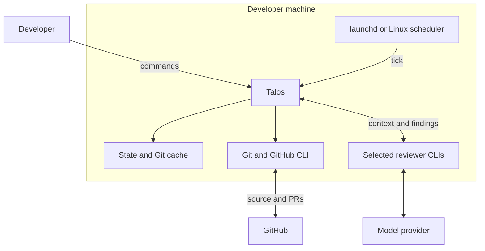

# Talos

Talos reviews GitHub pull requests from your machine using Codex, Claude Code, or Kimi Code. It records the ready PRs that already exist, then picks up new ready PRs, drafts that become ready, and new heads. Reviews stay local by default. Each repo can opt into comments and approvals separately.

## Use Talos

You need Zig 0.15.2, Git, GitHub CLI with `gh api --slurp`, and one reviewer CLI. On macOS, install the Xcode Command Line Tools. On Linux, run `talos tick` from your scheduler.

```sh
git clone https://github.com/paulbalaji/talos.git
cd talos
zig build -Doptimize=ReleaseSafe
mkdir -p "$HOME/.local/bin"
install -m 755 zig-out/bin/talos "$HOME/.local/bin/talos"
export PATH="$HOME/.local/bin:$PATH"
```

Sign in with `gh auth login` and sign in to your reviewer CLI. Replace `OWNER/REPO` and `123` with your repo and an open, ready PR.

```sh
talos add OWNER/REPO                   # Track this repo with your default reviewer
talos run-once OWNER/REPO 123          # Preview this PR, including a baselined PR
talos install                         # Start the macOS scheduler
talos status                          # See scans, queue, errors, and cache sizes
```

| Do this | Run |
| --- | --- |
| Preview a specific PR with a review mode | `talos run-once OWNER/REPO 123 --mode perf-maxxing` |
| Preview the next eligible reviews | `talos run-once` |
| Preview the next review in one repo | `talos run-once OWNER/REPO` |
| Show or set the reviewer default for new repos | `talos defaults` or `talos defaults --engine claude` |
| Queue a specific PR under the repo's publication policy | `talos queue OWNER/REPO 123` |
| Queue a numbered GitHub stack | `talos stack OWNER/REPO 10088` |
| Queue branches as an explicit stack | `talos stack OWNER/REPO feature 123 124 125` |
| Remove an explicit local stack definition | `talos unstack OWNER/REPO feature` |
| Inspect one repo or read JSON | `talos status OWNER/REPO` or `talos status --json` |
| Show or set the review budget per tick | `talos queue-budget` or `talos queue-budget 3` |
| Pause or resume reviews for a repo | `talos pause OWNER/REPO` or `talos resume OWNER/REPO` |
| Run one scheduler pass | `talos tick` |
| Remove the macOS scheduler | `talos remove` |
| List flags and commands | `talos --help` |

`run-once` always previews. `tick` uses the configured publication policy. A numbered preview also works while its repo is paused.

### Focus a review

Use a review mode on a numbered preview. Add `--prompt` to give the configured reviewers specific context or a question.

```sh
talos run-once OWNER/REPO 123 --mode perf-maxxing --prompt 'Check allocations on the request path.'
talos run-once OWNER/REPO 123 --mode reliability-maxxing
talos run-once OWNER/REPO 123 --mode security-maxxing
```

Performance covers hot paths and scaling. Reliability covers partial failure, retries, and recovery. Security checks trust boundaries and mitigations from static source. With no mode, Talos runs the general review. The prompt is sent to your configured reviewers, so keep credentials out of it.

### Review a PR stack

When Talos scans ready PRs, it uses the number and member order GitHub recorded for each `gh stack`. It reads that metadata through the GitHub API. Stack detection keeps the baseline intact and groups existing per-head jobs.

For PRs without a GitHub stack, Talos can infer a linear chain when each PR targets the previous PR's branch and exact head in the same repo. Ambiguous or branched relationships stay in the ordinary queue. You can also define a local stack with two to eight ready PRs in one repo, bottom to top.

```sh
talos stack OWNER/REPO 10088
talos stack OWNER/REPO feature 123 124 125
talos status OWNER/REPO
talos run-once OWNER/REPO 124
talos unstack OWNER/REPO feature
```

Talos waits for queued ancestor reviews or merges before starting the next scheduled PR. A baselined ancestor can contribute its pinned diff and any available review without starting a new model run. Reviewers see excerpts from the nearest ancestors, and Talos rechecks the entire ordered prefix before publication. Each PR keeps its own diff anchors and publication receipt. Use `status` to see the stack number, order, and why a PR is blocked. `unstack` removes an explicit local definition and keeps its queued jobs. A later scan can detect the chain again. [GitHub stack APIs](https://docs.github.com/en/pull-requests/reference/stacked-pull-requests-apis-and-webhooks)

### Configure each repo

Talos starts with Codex as the default. To use Claude Code on a Claude-only machine, run `talos defaults --engine claude` once. New repos use that setting unless you pass `--engine`. Existing repos keep their reviewer settings.

Run `add` again to update settings and carry forward the baseline and queue. Talos keeps the repo's reviewers, model, and executable paths when you omit their flags. Repeat any other settings you want to keep. Leaving out both publication flags returns the repo to dry-run.

```sh
talos add OWNER/REPO --engine codex --interval 180
talos add OWNER/REPO --engine claude --model sonnet
talos add OWNER/REPO --engine kimi --model kimi-code/kimi-for-coding
talos add OWNER/REPO --engine claude,codex --model sonnet
talos add OWNER/REPO --engine claude,codex,kimi --reviewer-model claude=sonnet --reviewer-model kimi=kimi-code/kimi-for-coding
talos add OWNER/REPO --engine claude,codex --claude-advisor off --reviewer-effort codex=medium
talos add OWNER/REPO --comments
talos add OWNER/REPO --approvals
talos add OWNER/REPO --comments --approvals
talos add OWNER/REPO --cache-mib 256 --cache-idle-days 14
talos add OWNER/REPO --cache-mib 0
```

At registration, Talos resolves Git, GitHub CLI, and each selected reviewer on PATH. Set paths explicitly with `--git`, `--gh`, `--codex`, `--claude`, or `--kimi`.

Use `--model MODEL` for the first reviewer, or repeat `--reviewer-model ENGINE=MODEL` for any selected reviewers. A named override takes precedence for that reviewer. When you set `--engine` again, repeat any model overrides you want to keep.

| Reviewer | Default model | Effort | Advisor |
| --- | --- | --- | --- |
| Codex | GPT-6.2 Sol (`gpt-6.2-sol`) | High | |
| Claude Code | Latest Opus (`opus`) | High | Latest Fable (`fable`) |
| Kimi Code | K3.1 Pro (`kimi-code/k3.1-pro`) | High | |

Use `--reviewer-effort ENGINE=LEVEL` to change effort. Use `default` to leave effort to the CLI. Codex and Claude accept `low`, `medium`, `high`, `xhigh`, and `max`. Kimi accepts `low`, `high`, and `max`. The chosen model must support the requested settings.

Talos requests standard serving speed in Codex and disables Claude's fast mode. It selects regular Kimi models and rejects model IDs named as premium speed variants. Use standard-speed routes when defining custom model aliases. [Codex speed](https://learn.chatgpt.com/docs/agent-configuration/speed) · [Claude fast mode](https://code.claude.com/docs/en/fast-mode) · [Kimi models](https://www.kimi.com/code/docs/en/kimi-code/models.html)

Fable receives the review context when Claude consults it. It requires Fable access and can use usage credits. Set `--claude-advisor off` on a repo to disable it. If your Kimi plan lacks K3.1 Pro, select an available model with `--reviewer-model kimi=MODEL`. [Claude advisor](https://code.claude.com/docs/en/advisor) · [Kimi models](https://www.kimi.com/code/docs/en/kimi-code/models.html)

Each reviewer in a list gets the same pinned source and discussion. Talos runs them in order, groups findings at the same diff line, and sends one review with reviewer attribution. A failed reviewer retries the job. Choose providers that can receive the repo's source and discussion.

`--comments` allows publishing a comment review. `--approvals` requires complete coverage and no findings from every configured reviewer, passing checks, no merge conflicts, and no unresolved threads. The author must differ from the configured GitHub identity. A clean candidate can become a comment when only comments are enabled.

### macOS build fallback

If Zig 0.15.2 cannot link against your macOS SDK, build with an explicit deployment target.

```sh
case "$(uname -m)" in
  arm64) talos_arch=aarch64 ;;
  x86_64) talos_arch=x86_64 ;;
esac
mkdir -p zig-out/bin
zig build-exe src/main.zig -lc -O ReleaseSafe \
  -target "$talos_arch-macos.15.0" --sysroot "$(xcrun --show-sdk-path)" \
  -femit-bin=zig-out/bin/talos
install -m 755 zig-out/bin/talos "$HOME/.local/bin/talos"
```

## How it fits together



Talos pins the PR head and base, computes their merge base, and sends bounded source and review threads to the reviewer. The context includes resolved threads and author replies. Repo content and GitHub discussion are untrusted input. Each reviewer runs in a temporary directory with local tools disabled. Codex also uses its read-only sandbox. Use provider accounts approved to receive that repo's source and discussion. Kimi Code may retain its own sessions.

Talos validates the result and checks inline locations against GitHub's diff. It checks the head, base, and threads before publication and verifies the review in GitHub afterward. GitHub binds the review to the head commit. Talos checks the base separately before submission. Partial coverage rules out automatic approval.

## Operate Talos

The macOS job is `dev.talos.watcher`. It wakes every 15 seconds while the Mac and user session are available. Repos poll every 180 seconds by default. launchd uses the installation PATH and the scheduled user's login. Keep credentials in CLI logins, supported environment variables such as `GH_TOKEN`, or a secret manager. See [security](SECURITY.md).

```sh
launchctl print "gui/$(id -u)/dev.talos.watcher"
talos status --json
```

The state directory is `~/.local/state/talos`. One process holds its lock at a time. Each tick admits up to three independent PRs per repo across five repos. Model reviews run in parallel. One coordinator collects source, updates state, and handles GitHub publication. PRs in a stack still wait for queued ancestors. `state.json` holds reviewer defaults, the baseline, queue, stacks, publication receipts, and recent errors. `repos/OWNER/REPO/results/` holds candidate reviews. Check `launchd.log` for scheduler errors.

The machine budget defaults to 15 reviewer starts per tick for new installs. Existing installs keep their saved limit. A PR with two configured reviewers reserves two starts. The same limit applies separately to receipt lookups, which use GitHub calls and zero reviewer starts. Set it with `talos queue-budget 15`. It must fit the largest configured reviewer list. Unserved work stays queued, and Talos rotates between repos across restarts. `status` shows the next eligible PR and the last active tick's review starts and GitHub CLI calls. Each repo keeps its own scan interval and Git cache limits.

A recognized GitHub rate limit holds scans and review jobs. A recognized reviewer rate limit holds jobs that use that reviewer. Talos saves these cooldowns across restarts and backs off from 60 seconds up to 16 minutes. During a GitHub cooldown it can hold up to 15 finished analyses for reuse. Reuse requires the same review inputs and fresh checks before publishing.

Job retries back off from 30 seconds, with six attempts per head. Use `queue` to retry. If a POST may have reached GitHub, Talos retries the receipt lookup and leaves the head `uncertain` until it can confirm the result. Run one publisher per repo because GitHub has no cross-machine idempotency key for reviews.

### Git cache

Each watched repo has a Talos-owned bare cache at `repos/OWNER/REPO/objects.git`. Talos fetches Git history directly from GitHub and downloads file contents as needed. V0 registrations carry forward automatically, and Talos discards caches from the old checkout-based workflow.

Talos checks the cache after source collection and every hour. It evicts the whole cache above **128 MiB** or after **seven idle days** by default. The next review rebuilds it. A fetch can temporarily exceed the retained limit. Set `--cache-mib 0` to discard the cache after every snapshot. `status` shows cache file sizes in bytes.

### Test a build alongside the installed watcher

```sh
test_state=$(mktemp -d /tmp/talos-check.XXXXXX)
zig-out/bin/talos --home "$test_state" add OWNER/REPO
zig-out/bin/talos --home "$test_state" run-once OWNER/REPO 123
zig-out/bin/talos --home "$test_state" install --label dev.talos.test
launchctl print "gui/$(id -u)/dev.talos.test"
zig-out/bin/talos --home "$test_state" remove --label dev.talos.test
```

Use `talos remove` to stop the default scheduler and keep its data. For a full uninstall, remove the binary and the state directory after saving any records you need.

## Develop Talos

| Change | Start here |
| --- | --- |
| CLI parsing, registration, and scheduling | `src/repo_config.zig`, `src/main.zig`, `src/launchd.zig` |
| Discovery, retries, and publication policy | `src/core.zig`, `src/store.zig` |
| Review budget, scheduling order, and cooldowns | `src/queue.zig` |
| PR stacks and inherited context | `src/stack.zig` |
| Git snapshots, anchors, and cache eviction | `src/source.zig`, `src/cache.zig` |
| GitHub API | `src/github.zig` |
| Reviewer adapters and result schema | `src/reviewers/`, `src/runner.zig`, `src/review-schema.json` |

Each reviewer adapter sets its allowed environment, builds the CLI invocation, and extracts the result. Register new adapters in `src/runner.zig` and add the corresponding engine and executable to the CLI. The shared pipeline validates findings and handles GitHub publication.

```sh
zig fmt --check build.zig src
zig build test
gitleaks git --redact --no-banner
git config core.hooksPath .githooks      # Optional local checks with Gitleaks installed
```

Use Conventional Commits for commit subjects and PR titles. CI checks both and runs on macOS and Linux. Keep GitHub mutation in the Zig process, leave model tools disabled, and preserve exact-commit readback and deduplication. The resolved-thread regression is based on [Hyperlane PR #10122](https://github.com/hyperlane-xyz/hyperlane-monorepo/pull/10122).

Write docs with commands, expected behavior, and the conditions that change what the reader should do. The review design and docs draw on Paul's [review skills](https://github.com/paulbalaji/skills) and [writing guide](https://github.com/paulbalaji/skills/tree/main/write-like-paul).

[MIT license](LICENSE)
